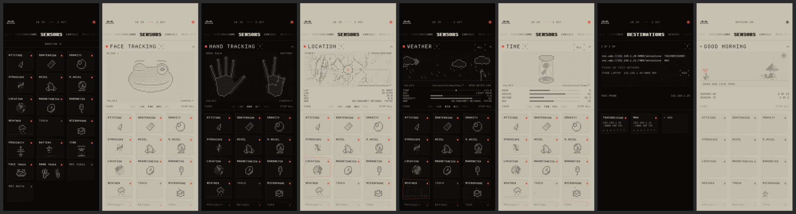

# SensorLove

**Sensor Toys that Speak OSC.** SensorLove turns your iPhone into a live sensor for your own creative tools. Switch a sensor on, add your computer as a destination, and its values arrive as OSC.

Free, with no ads, no accounts, no tracking and nothing locked. [Get it on the App Store](https://apps.apple.com/app/sensorlove/id6760937599).

- [sensor.love](https://sensor.love): the website
- [Getting started](docs/getting-started.md)
- [Sensors](docs/sensors.md): every sensor and every address it sends
- [OSC](docs/osc.md): how the values travel
- [Changelog](CHANGELOG.md) · [Privacy](docs/privacy-policy.md)

## Inside

- The interface is one HTML page, `WebUI/home.html`, in a WKWebView. It also runs in a browser, with touch and location as its live sensors.
- The sensors, OSC and recording are Swift, in `App/`. The Xcode project is generated from `project.yml` by XcodeGen.
- The website is `site/`. `site/build.py` builds it from these docs, and writes `docs/sensors.md` from the app's own address table, so the reference always matches what the app sends. Its hero is the app's own page, playing its sensors.

## Licence

© 2026 Göktuğ Güntav. SensorLove is free software under the [GNU GPL v3](LICENSE), with two [additional terms](ADDITIONAL-TERMS.md) and one permission:

- copies, and works based on it, keep the credit "Based on SensorLove by Göktuğ Güntav (sensor.love)";
- the name SensorLove, the frog and the heart are not licensed: a changed version gets its own name and icon;
- it may be linked with the NDI® SDK, which is not free software, for VIDEO and DEPTH. The SDK is not in this repository; without it SensorLove builds without NDI.

Want to help? See [Contributing](CONTRIBUTING.md) and the [code of conduct](CODE_OF_CONDUCT.md).

Weather data by [Open-Meteo.com](https://open-meteo.com/) · Departure Mono by Helena Zhang, SIL Open Font License 1.1
